# AI Customer Support Architecture Blueprint

## 1. Purpose and Scope

This document describes the architecture, components, runtime behavior, data model, and
development conventions for the AI customer-support application.

The application monitors a Gmail inbox, classifies incoming customer threads, optionally
generates a support reply, applies deterministic business rules, and escalates messages that
require human handling. It does not perform fulfillment or payment actions: actions such as
shipping, replacement, and exchange are represented as proposed actions for an operator.

### Goals

- Triage customer email safely and consistently.
- Use a restricted knowledge base as the source of support answers.
- Keep AI-generated recommendations separate from deterministic policy decisions.
- Make every inbound Gmail message retriable and observable.
- Route ambiguous, risky, or policy-sensitive requests to a human.
- Preserve ticket and message history for operations and auditing.

### Architectural principles

1. **Models propose; Python decides.**
2. **Escalation is fail-safe** for attachments, unsafe requests, insufficient knowledge, or
   unsupported issue resolution.
3. **Database writes and Gmail side effects are auditable.**
4. **Knowledge is data, not application code.**
5. **The poller owns inbound scheduling; the API is an operational interface.**

## 2. System Context

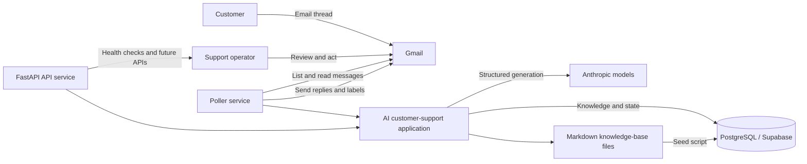

### External systems

| System | Responsibility |
|---|---|
| Gmail | Source of incoming email, thread history, labels, and outbound replies |
| Anthropic API | Classification and support-answer generation through Pydantic AI |
| PostgreSQL / Supabase | Durable ticket, message, event, and knowledge-base storage |
| Markdown knowledge base | Editable source content reviewed or seeded into PostgreSQL |

## 3. Container and Deployment Architecture

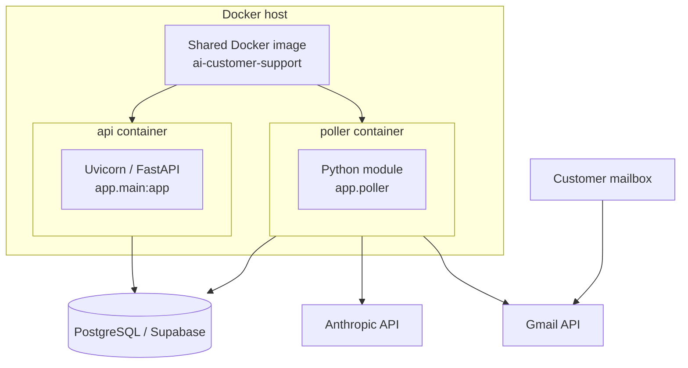

Both containers use the image and environment configuration declared in
`docker-compose.yml`. The API binds only to loopback port 8080 on the host. The poller runs
continuously, polls every configured interval, and processes up to ten new Gmail messages per
cycle.

### Runtime commands

```text
API:    uvicorn app.main:app --host 0.0.0.0 --port 8080
Poller: python -m app.poller
```

## 4. Logical Component Architecture

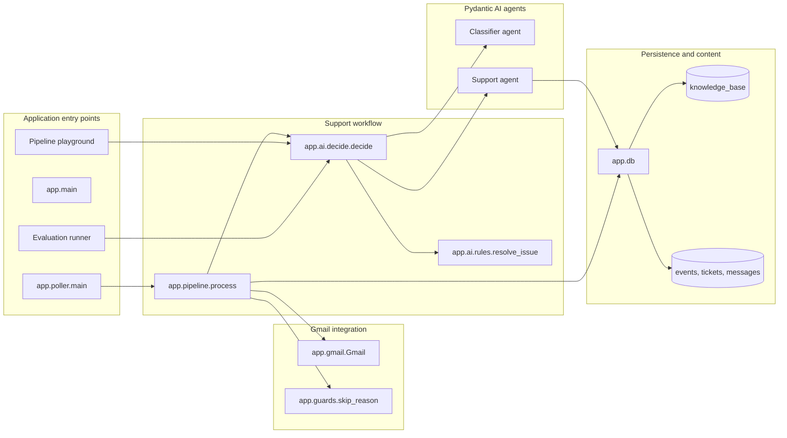

| Component | File | Responsibility |
|---|---|---|
| Poll scheduler | `app/poller.py` | Gmail service lifecycle and periodic processing |
| Pipeline | `app/pipeline.py` | Message lifecycle, persistence, Gmail replies, labels |
| Inbox guards | `app/guards.py` | Reject sent, own, automated, and bulk mail |
| Gmail adapter | `app/gmail.py` | Gmail API calls, headers, thread formatting, attachments |
| Decision orchestrator | `app/ai/decide.py` | Classifier and support agent orchestration plus policy gates |
| Classifier | `app/ai/classifier.py` | Section, escalation, language, and acknowledgement generation |
| Support agent | `app/ai/agent.py` | Knowledge-grounded reply generation and issue extraction |
| Issue rules | `app/ai/rules.py` | Deterministic next-step decisions for supported products |
| Schemas | `app/ai/schemas.py` | Structured model contracts and decisions |
| Database repository | `app/db.py` | PostgreSQL repositories for workflow and knowledge-base data |

## 5. Agent Creation and Consumption

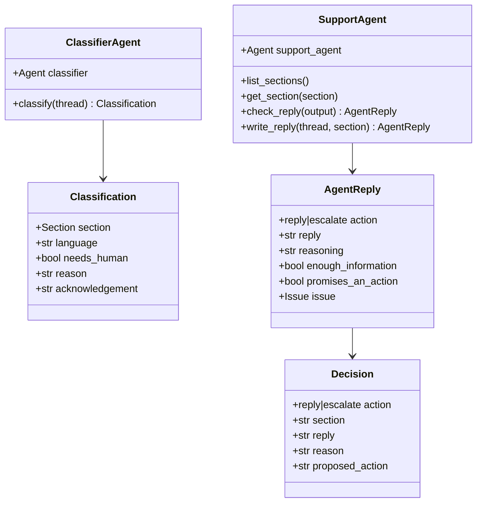

### Classifier agent

Created once at module import in `app/ai/classifier.py`:

```python
classifier = Agent(
    settings.classifier_model,
    output_type=Classification,
    instructions=INSTRUCTIONS,
)
```

Consumed through `classify(thread)`, which calls `classifier.run_sync(thread)`. The classifier
chooses a knowledge-base section, determines whether a request is an always-escalate case, and
produces a human-friendly acknowledgement.

### Support agent

Created once at module import in `app/ai/agent.py`:

```python
support_agent = Agent(
    settings.agent_model,
    output_type=AgentReply,
    instructions=INSTRUCTIONS,
)
```

Consumed through `write_reply(thread, section)`, which calls
`support_agent.run_sync(prompt)`.

The support agent has two tools backed by PostgreSQL:

- `list_sections()` lists available knowledge domains.
- `get_section(section)` retrieves entries for a selected domain.

The output validator rejects an empty customer reply in `reply` mode and replies containing
disallowed references to AI or the knowledge base.

## 6. End-to-End Processing Sequence

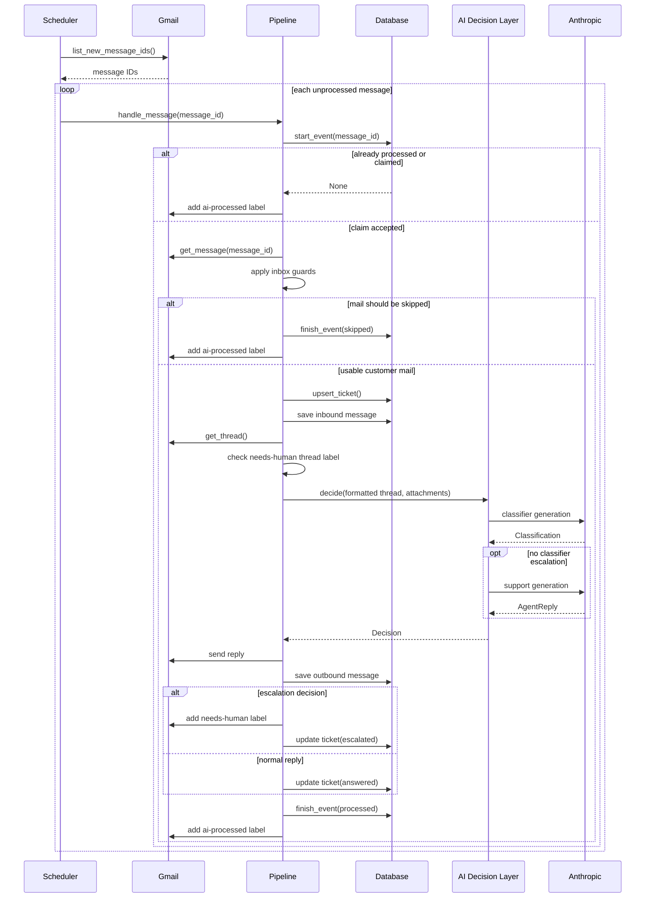

## 7. Decision Workflow

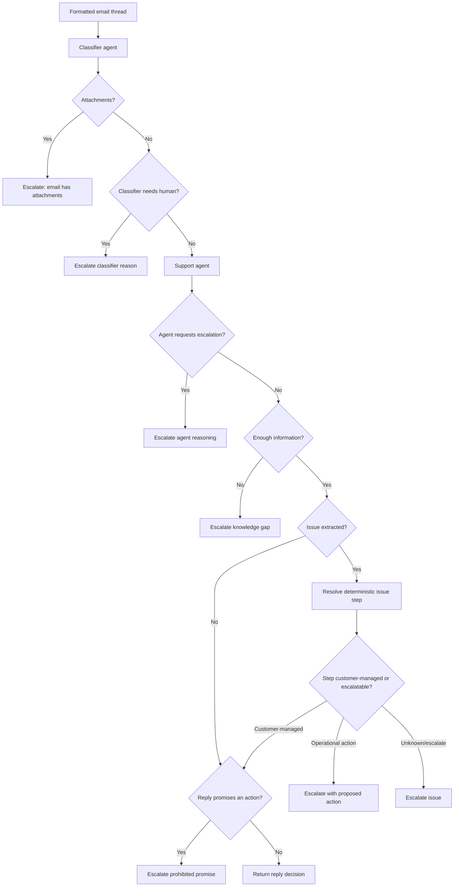

### Current escalation gates

| Gate | Behavior |
|---|---|
| Sent by own mailbox, automated, bulk, or list mail | Skip and mark processed |
| Thread already has `needs-human` label | Skip the thread |
| Message has attachments | Escalate |
| Classifier policy rule matches | Escalate |
| Support agent requests escalation | Escalate |
| Knowledge base is insufficient | Escalate |
| Product issue maps to an operator action | Escalate with proposed action |
| Reply promises a refund, shipment, replacement, date, or call | Escalate |

Escalation output includes a customer acknowledgement generated by the classifier, allowing
the thread to receive a polite interim response while an operator owns follow-up.

## 8. Product Issue State Model

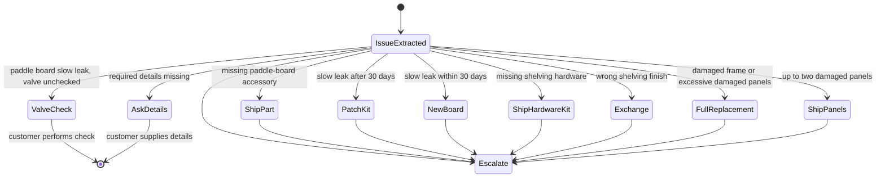

Customer-managed steps (`valve-check`, `ask-details`) are allowed in the automated response
path. Operational steps are proposed actions and require escalation.

## 9. Persistent Data Model

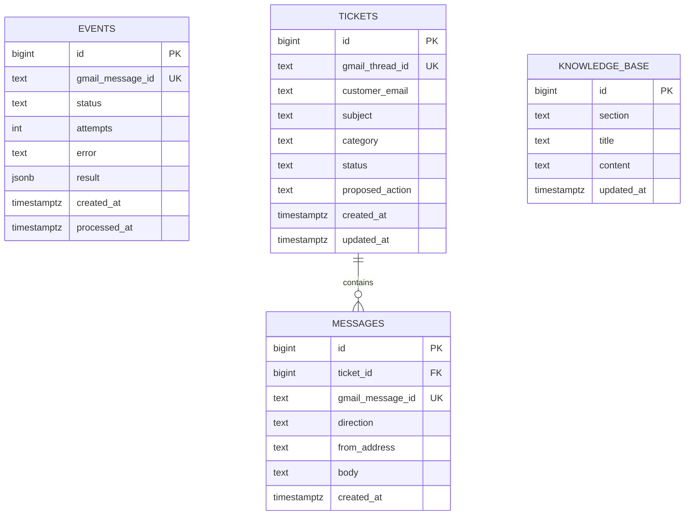

### Entity lifecycle

- `events` is the processing claim ledger. It deduplicates Gmail messages and records retries,
  failures, and final outcomes.
- `tickets` represents one Gmail thread.
- `messages` stores inbound customer messages and outbound support responses.
- `knowledge_base` stores reusable support content grouped by section.

All tables except `knowledge_base` are enabled with Row Level Security in the migration. The
production application accesses PostgreSQL through its direct database connection rather than
through Supabase client policies.

## 10. Ticket and Event State

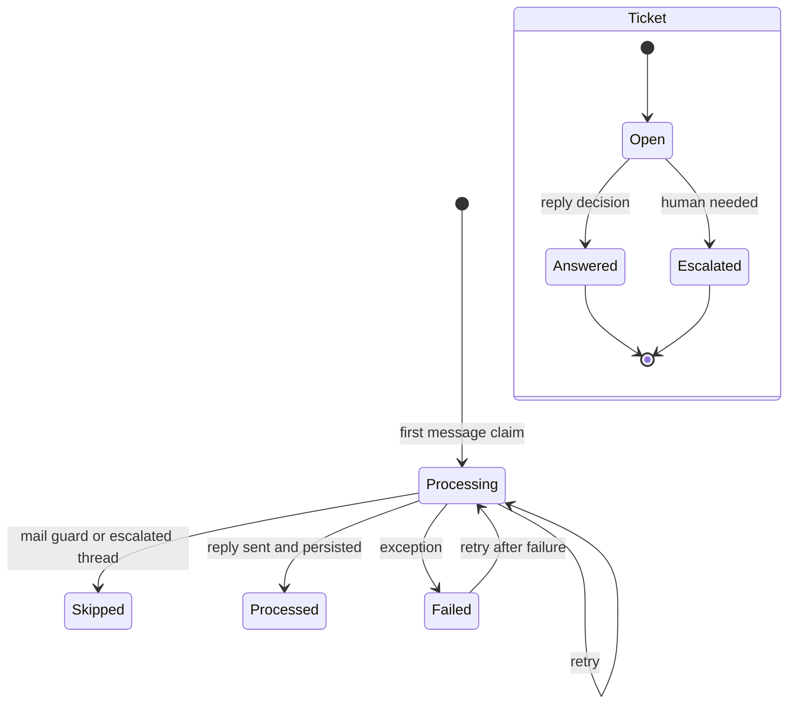

## 11. Knowledge-Base Architecture

Knowledge source files are organized by section under `knowledge_base/`:

```text
knowledge_base/
├── brand-and-tone.md
├── escalation-rules.md
├── paddle-boards.md
├── returns-and-warranty.md
├── shelving.md
└── shipping.md
```

Each file is split on level-two Markdown headings by `scripts/seed_knowledge_base.py`. The
section is the file stem; each heading is stored as a title and the text below it is stored as
content.

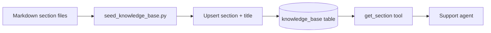

The support agent is instructed to use the `brand-and-tone` and `escalation-rules` sections,
plus the section selected by the classifier.

## 12. Configuration and Secrets

Settings are loaded by `app/config.py` with `pydantic-settings`.

| Setting | Purpose |
|---|---|
| `GOOGLE_CLIENT_ID` | Gmail OAuth client identifier |
| `GOOGLE_CLIENT_SECRET` | Gmail OAuth client secret |
| `GOOGLE_REFRESH_TOKEN` | Long-lived Gmail OAuth credential |
| `DATABASE_URL` | PostgreSQL connection string |
| `CLASSIFIER_MODEL` | Pydantic AI classifier model |
| `AGENT_MODEL` | Pydantic AI support model |
| `POLL_INTERVAL_SECONDS` | Delay between inbox polling cycles |
| `DASHBOARD_USERNAME` | Reserved dashboard configuration |
| `DASHBOARD_PASSWORD` | Reserved dashboard configuration |

The application loads `.env` for local execution and uses Docker `env_file: .env` for containers.
Secrets must remain outside source control and must not be logged.

## 13. Repository Structure

```text
app/
├── ai/
│   ├── agent.py          Support agent and knowledge tools
│   ├── classifier.py     Classification agent
│   ├── decide.py         AI orchestration and policy gates
│   ├── rules.py          Deterministic issue resolution
│   └── schemas.py        Pydantic AI contracts
├── config.py             Environment-backed settings
├── db.py                 PostgreSQL repository functions
├── gmail.py              Gmail API adapter and email helpers
├── guards.py             Inbound mail safety guards
├── main.py               FastAPI service
├── pipeline.py           Gmail processing workflow
└── poller.py             Polling entry point

evals/
├── golden_emails.py      Evaluation fixtures
└── run_evals.py          Pipeline evaluation harness

knowledge_base/
scripts/
playground/
supabase/migrations/
docker-compose.yml
Dockerfile               Container build definition
pyproject.toml
```

## 14. Error Handling and Retry Strategy

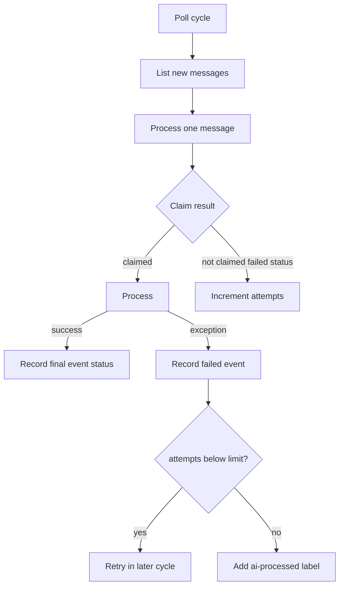

One failed Gmail message does not stop processing of the remaining batch. Database event
attempts provide deduplication and retries. The maximum-attempt behavior in the pipeline
prevents a consistently failing message from looping indefinitely by adding the processed
label after the configured maximum attempts.

Expected improvements include structured error types, classification/agent timeout budgets,
retry jitter, provider-level retries, and an explicit dead-letter status.

## 15. API and Operational Surface

The current API exposes:

- `GET /health`: service liveness.

Future operational features that fit the architecture:

- ticket list and detail endpoints
- escalation inbox and proposed-action management
- processing event history and retry controls
- knowledge-base preview and publication status
- model cost, latency, and token metrics
- human-in-the-loop approval before fulfillment actions

The dashboard settings are reserved but no dashboard routes are implemented yet.

## 16. Evaluation and Verification Blueprint

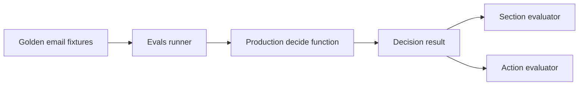

Evaluation should cover:

- every knowledge-base section
- always-escalate language and intent
- attachments
- missing details
- issue resolution for every supported product/problem combination
- prohibited promised actions
- empty or disallowed support replies
- duplicate and interrupted message processing
- Gmail parser behavior for HTML, plain text, quoted text, and attachments
- knowledge-base retrieval misses

## 17. Security and Safety Blueprint

### Current controls

- Gmail OAuth scopes are limited to Gmail modify access.
- Mail guards reject own, automated, bulk, list, and junk messages.
- Attachment messages are escalated.
- AI replies are validated for required structure and prohibited mentions.
- Operational promises are prohibited in customer replies.
- Escalation preserves human ownership through the `needs-human` label.
- Database row-level security is enabled.

### Required controls for production

- Store OAuth and database credentials in a managed secret store.
- Restrict database network access and application database privileges.
- Add immutable processing logs and audit trails for human actions.
- Redact customer data before including logs in observability systems.
- Apply a human approval gate before all external fulfillment actions.
- Add model and prompt version metadata to decisions.
- Add provider cost ceilings, rate limits, and prompt-injection defenses.
- Review and constrain knowledge-base content through a publishing workflow.

## 18. Scalability and Reliability Blueprint

The baseline architecture can handle low-volume polling, but production scale should add:

- a durable job queue such as PostgreSQL SKIP LOCKED, Redis, or SQS instead of a single poller.
- event-driven Gmail ingestion via Pub/Sub or webhook-like notification.
- independent worker processes and bounded concurrency.
- idempotency at every outbound side-effect.
- provider circuit breakers and per-model budgets.
- distributed tracing with correlation IDs based on Gmail thread or message IDs.
- read replicas for reporting without affecting transaction processing.
- feature flags for agent rollout and fallback behavior.

## 19. Implementation Invariants

Development should preserve these invariants:

1. Every Gmail message ID is claimed and recorded once.
2. A thread can have only one durable ticket identity.
3. Outbound Gmail messages are persisted.
4. A classified answer is never sent if a policy gate escalates it.
5. Agent output must conform to its Pydantic schema.
6. Product fulfillment actions are not executable by the agent.
7. Customer-facing replies contain no unsupported promises or unverified facts.
8. Every processed batch item is isolated so one failure cannot stop the batch.
9. The knowledge base is the answer authority; prompts and tool definitions provide usage rules.
10. A human-labeled `needs-human` thread remains owned by a human until the label is removed.

## 20. Blueprint for Planned Development

### Phase 1 - Hardening current implementation

- Complete API startup and polling documentation.
- Add automated unit and integration tests around guards, Gmail formatting, and policy rules.
- Add CI for linting, type checks, migrations, and evaluations.
- Fix Docker build filename and standardize command/configuration examples.
- Add explicit startup validation for required environment variables.

### Phase 2 - Human operations

- Add authenticated ticket and escalation endpoints.
- Provide dashboard views for inbox state, proposed actions, and knowledge grounding.
- Add operator actions that require explicit approval.
- Record actor, time, and action provenance for ticket changes.

### Phase 3 - Event-driven ingestion

- Replace polling as the primary ingestion mechanism with Gmail notifications.
- Move messages into a durable queue.
- Scale workers independently from API capacity.
- Add renewal and failure handling for notification subscriptions.

### Phase 4 - Production AI governance

- Version prompts and classifier/support models.
- Store decisions, model versions, source knowledge entries, latency, and token usage.
- Introduce offline evaluation gates for prompt and model changes.
- Add model fallback policies and provider health monitoring.

### Phase 5 - Multi-channel support

- Introduce channel adapters behind a common conversation interface.
- Reuse classification, policy, knowledge retrieval, and ticket workflows across email, chat,
  and support-ticket systems.
